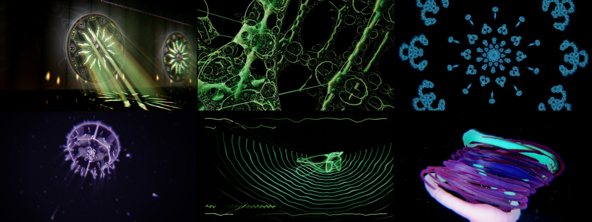
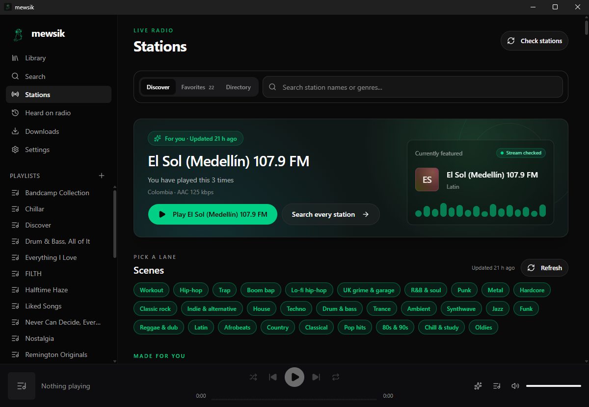
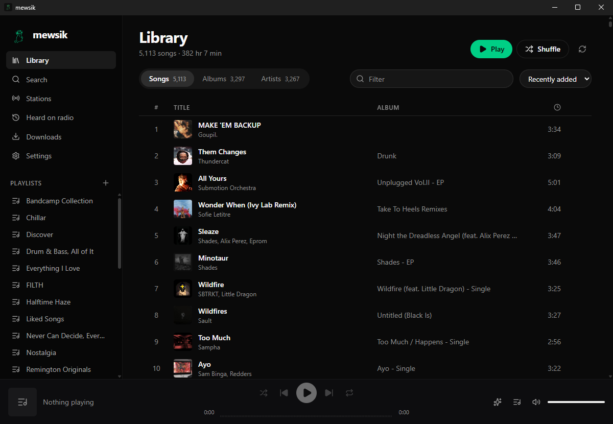
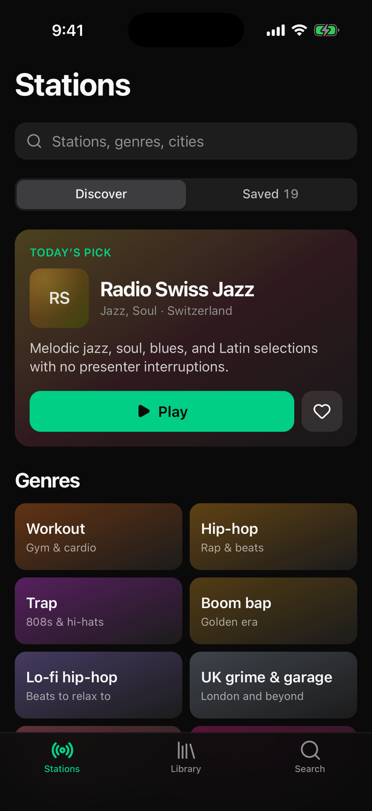
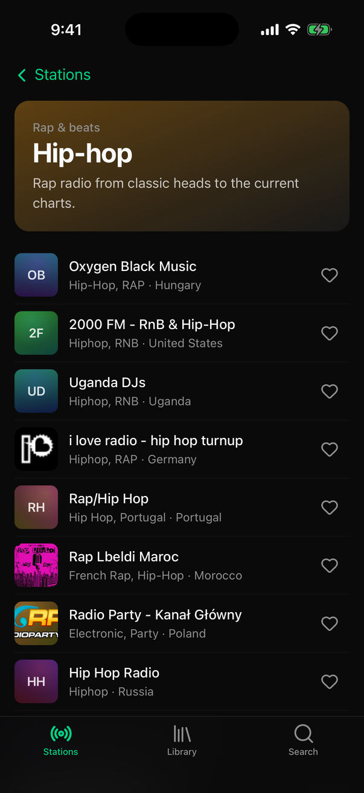
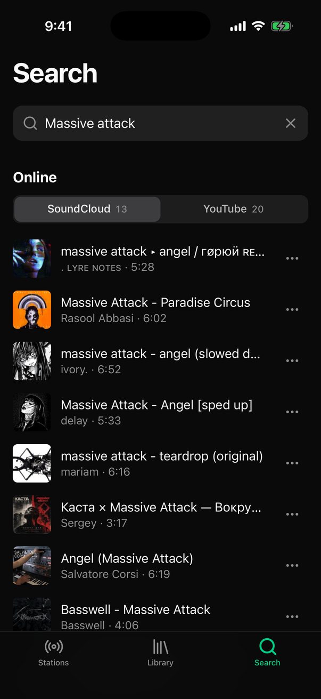

<p align="center">
  
</p>

<h1 align="center">mewsik</h1>

<p align="center">
  <b>Your music, 50,000+ live radio stations, and a real-time visualizer, in one app.</b><br>
  Open source, for Windows, macOS and iPhone. Built with Rust, Tauri, Svelte and WebGPU.
</p>

<p align="center">
  <a href="https://github.com/RemingtonWilcox/mewsik/releases/latest"></a>
  
  <a href="LICENSE"></a>
</p>

<p align="center">
  <a href="https://github.com/RemingtonWilcox/mewsik/releases/latest"><b>Download for Windows or Mac</b></a>
  &nbsp;·&nbsp;
  <a href="https://testflight.apple.com/join/5GCnVzzR"><b>Get the iPhone beta on TestFlight</b></a>
</p>

<p align="center">
  
</p>

## What it does

- **Live radio.** 50,000+ stations from the open [radio-browser](https://www.radio-browser.info/) directory. Browse by genre, get a fresh pick every day, save favorites, and see the song each station is playing. mewsik checks streams for you and quietly drops the dead ones.
- **Your library.** Point it at your music folder and get songs, albums, artists, playlists and listening history, all stored locally.
- **Search and download.** One search box covers YouTube and SoundCloud (plus Bandcamp on desktop). Play results straight away, or download them and they land in your library.
- **A real-time visualizer.** Five procedural engines react to whatever is playing, radio included.
- **iPhone app.** The same library, search and stations, redesigned for the phone.
- **Keyboard first.** `Ctrl+K` / `Cmd+K` to search, `Space` to play or pause, `H` to hide the visualizer chrome.

## Screenshots

<p align="center">
  
</p>

<p align="center">
  
</p>

<p align="center">
  
  &nbsp;
  
  &nbsp;
  
</p>

## The visualizer

Every frame is generated on the GPU from the audio. Nothing is prerendered, sampled or AI-generated.

- **Live audio analysis in Rust**: spectrum, onsets, tempo, beat phase and key, streamed to the renderer.
- **A musical director** turns those features into beats, bars, phrases, builds and drops, and notices a change of genre or tempo within about two seconds.
- **WGSL shaders on WebGPU**: raymarched signed distance fields and 3D fractals (Mandelbulb, Menger sponge, Kleinian and Apollonian sets), volumetric light, and a compute pass that turns ribbons into light sources.
- **HDR post stack**: temporal feedback, bloom, chromatic aberration and dither.
- **A seeded variation genome**: palettes, cameras, shapes and lighting mutate on musical boundaries and glide between states, so the picture keeps evolving without jump cuts.

| Engine | What it is |
|--------|-----------|
| **Prism** | A stained-glass rose window in a dark nave, with light shafts thrown through the glass |
| **Mandala** | A voyage through fractal worlds: Kaliset filigree, Julia spiral dives, Menger and Kleinian caverns, the Mandelbulb |
| **Soma** | A bioluminescent deep-sea organism drifting in 3D water |
| **Signal** | A phosphor oscilloscope that draws the music as living traces |
| **Loom** | Woven ribbons of light that are the only light in the room |

## Install

Grab the latest build from the [Releases page](https://github.com/RemingtonWilcox/mewsik/releases/latest).

| Platform | File | First launch |
|----------|------|--------------|
| **Windows 10/11** (x64) | `mewsik_<version>_x64-setup.exe` | The installer isn't code-signed yet. If SmartScreen warns about an unknown publisher, choose **More info → Run anyway**. Installs for your user only; no admin needed. |
| **macOS 13.5+** (Apple Silicon) | `mewsik_<version>_aarch64.dmg` | Drag mewsik to Applications. It's signed but not yet notarized, so the first time, right-click the app and choose **Open**. |
| **iPhone** | [TestFlight beta](https://testflight.apple.com/join/5GCnVzzR) | Install the TestFlight app, then open the link on your phone. |

There's no in-app updater yet; download new versions from the Releases page. Your library, settings and downloads are kept when you install over an older version.

## Build from source

You need [Node.js](https://nodejs.org/) 24.15.0 (pinned in `.node-version`), [pnpm](https://pnpm.io/) 10.11.0 and [Rust](https://rustup.rs/) (`rust-toolchain.toml` installs the pinned toolchain). On Windows, add the Microsoft C++ Build Tools; on macOS, the Xcode Command Line Tools.

```bash
git clone https://github.com/RemingtonWilcox/mewsik.git
cd mewsik
pnpm install --frozen-lockfile
pnpm tauri:dev      # run in development
pnpm tauri:build    # build an installer for this machine
```

Installers land in `src-tauri/target/release/bundle/`. The iPhone app builds on a Mac with Xcode (`pnpm tauri ios build`). Signing, notarization, versioning and the release checklist are in [docs/releasing.md](docs/releasing.md).

## Where your data lives

Everything stays on your machine. The library database is in `%APPDATA%\mewsik\mewsik\data` on Windows and `~/Library/Application Support/app.mewsik.mewsik` on macOS. Downloads go to `Music/Mewsik` by default (you can change this in Settings). Before a database upgrade, mewsik saves a backup next to the database and keeps the three newest.

## Tech stack

| Layer | Technology |
|-------|-----------|
| App shell | [Tauri 2](https://tauri.app/) |
| Frontend | [Svelte 5](https://svelte.dev/) + [SvelteKit](https://kit.svelte.dev/), [Tailwind CSS 4](https://tailwindcss.com/), [shadcn-svelte](https://shadcn-svelte.com/) |
| Backend | Rust |
| Audio | [rodio](https://github.com/RustAudio/rodio) + [Symphonia](https://github.com/pdeljanov/Symphonia), FFmpeg for radio and downloads |
| Database | SQLite via [rusqlite](https://github.com/rusqlite/rusqlite) |
| Visualizer | WebGPU + WGSL, live audio analysis in Rust |
| Online sources | Node.js sidecar with [youtubei.js](https://github.com/LuanRT/YouTube.js), [soundcloud-fetch](https://github.com/patrickkfkan/soundcloud-fetch) and [bandcamp-fetch](https://github.com/patrickkfkan/bandcamp-fetch); on iPhone these run inside the app |

## Project structure

```
mewsik/
  src/                  Svelte frontend
    routes/             Pages: library, search, stations, downloads, settings
    lib/components/     UI (desktop and mobile/ for the phone)
    lib/state/          App state (player, library, downloads)
  src-tauri/            Rust backend
    src/audio/          Playback, streaming and analysis
    src/stations/       Radio directory, health checks, logos
    src/sources/        Online providers and the sidecar manager
    src/db/             SQLite models, queries and migrations
    gen/apple/          Xcode project for the iPhone app
  sidecar/              Node.js sidecar for online sources (desktop)
```

## Contributing

Issues and pull requests are welcome. See the [issues](https://github.com/RemingtonWilcox/mewsik/issues) for what's open.

## License

[MIT](LICENSE)
